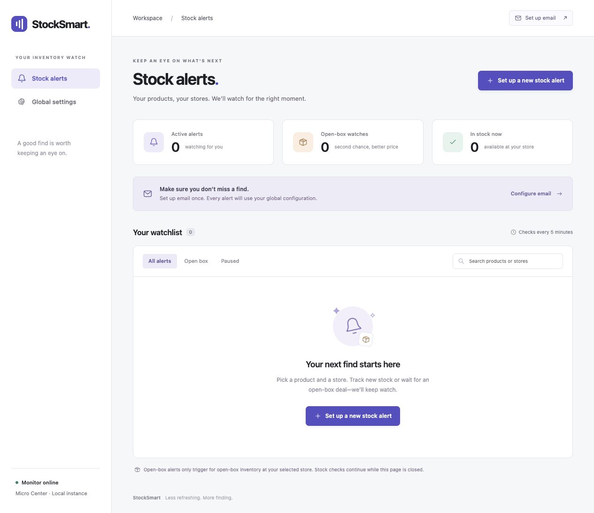

# StockSmart

A self-hosted web dashboard for Micro Center stock alerts. Watch a product at a specific store, choose regular new stock or open-box inventory, and receive email when availability changes.

This project is a fork of [ayoTyler/StockSmart](https://github.com/ayoTyler/StockSmart), originally created by [ayoTyler](https://github.com/ayoTyler) as the Micro Center Stock Application (MCSA). This fork adds the web UI, persistent alerts, store selection, open-box tracking, and background notification worker. The web application replaces the original terminal script.

[Buy me a coffee](https://buymeacoffee.com/ryanlevi)



## Features

- Global email settings shared by every alert, with a test-email button.
- A dropdown of 31 named Micro Center locations, including Tustin (`101`).
- Product-link alerts for either regular new stock or open-box inventory.
- Store-specific open-box counts, starting prices, and listing IDs when exposed by the product page.
- Pause/resume, edit, delete, check-now, search, and check history.
- One global, clock-aligned schedule for all active alerts, with separate first/manual check requests.
- One HTTP session per store in each batch and one fetch per product/store, shared by both stock types.
- Apify hosted inventory provider: one store-scoped Actor run per batch returns product and open-box inventory for all alerts at that store.
- Direct HTTP remains available as a diagnostic source; the automated provider can be configured under Global settings.
- Persistent SQLite storage and a background worker that runs while the UI is closed.
- Duplicate-email suppression and retries after failed delivery.
- Encrypted SMTP passwords on disk, CSRF-protected forms, and validated product URLs.

## The flow

1. Open the web UI and configure email under **Global settings**.
2. Use **Save & send test email** to verify your configuration.
3. Choose **Set up a new stock alert**.
4. Select the store by name and paste a Micro Center product link.
5. Check **Track open box** to watch open-box inventory only. Leave it unchecked for the regular new product.
6. Select **Create stock alert**.

The dropdown overrides any store ID embedded in the pasted link. Create separate alerts if you want to track both stock types for the same product and store.

Store IDs come from the [official Micro Center store selector](https://www.microcenter.com/site/stores/default.aspx), checked October 30, 2026. Leading zeroes, such as Westmont (`025`), are preserved.

## Requirements

- Python 3.12 (tested on Ubuntu 24.04).
- Git and Python virtual-environment support.
- An SMTP mail server/account for email notifications.

The Apify provider uses the community-maintained [Micro Center Product Scraper](https://apify.com/memo23/microcenter-product-scraper) Actor to retrieve store-specific inventory, including open-box listings. An Apify account and API token are required. The token is encrypted in the StockSmart data directory. The Actor is third-party software; confirm that its results and billing work for your account before relying on scheduled checks.

Direct HTTP mode requests Micro Center’s public product pages and does not install or launch Selenium/Chrome. It is retained as a diagnostic option and may be blocked by Micro Center. Generic shipping/JSON-LD availability is not used as a substitute for store-specific new/open-box stock.

For the optional **HTTP first — browser for incomplete HTML** mode, install Google Chrome and `pip install -r requirements-browser.txt`. ChromeDriver is downloaded automatically by `webdriver-manager`. Run Chrome as an unprivileged user; its sandbox remains enabled. Explicit HTTP denials, verification challenges, and rate limits never trigger browser escalation.

## Installation

```bash
git clone https://github.com/ryanlevi/StockSmart.git
cd StockSmart
python3 -m venv .venv
source .venv/bin/activate
pip install -r requirements.txt
```

Run the web UI and worker in separate terminals from the checkout, using the same data directory:

```bash
# Terminal 1: web UI
export STOCKSMART_DATA="$PWD/data"
waitress-serve --host=127.0.0.1 --port=8080 --call stocksmart:create_app
```

```bash
# Terminal 2: polling and email worker
source .venv/bin/activate
export STOCKSMART_DATA="$PWD/data"
python -m stocksmart.worker
```

Open [http://localhost:8080](http://localhost:8080). To serve your trusted LAN, bind to `0.0.0.0` and use the machine's LAN IP. This is a single-user application without a login screen; keep it on a trusted LAN or put it behind authenticated access before exposing it elsewhere.

### Proxmox / systemd

Run StockSmart inside an Ubuntu VM. Example starting resources: 2 vCPUs, 4 GB RAM, and a 40 GB disk. The VM needs Internet access for Micro Center, ChromeDriver downloads, and email delivery.

Example service files are in [`deploy/`](deploy/). They assume the `ubuntu` user, a checkout at `/home/ubuntu/projects/StockSmart`, and runtime data at `/home/ubuntu/.local/share/stocksmart`. Adjust those paths and the user before installing if your setup differs.

```bash
sudo install -m 644 deploy/stocksmart-web.service /etc/systemd/system/
sudo install -m 644 deploy/stocksmart-worker.service /etc/systemd/system/
sudo systemctl daemon-reload
sudo systemctl enable --now stocksmart-web stocksmart-worker
```

The supplied web service listens on port `8080`. Both services start automatically with the VM.

```bash
sudo systemctl status stocksmart-web stocksmart-worker
sudo systemctl restart stocksmart-web stocksmart-worker
sudo journalctl -u stocksmart-worker -n 50
curl http://127.0.0.1:8080/health
```

## Email configuration

Email currently uses SMTP. For Gmail, use `smtp.gmail.com`, port `587`, STARTTLS, your email address as the SMTP username, and a Gmail app password. Enter sender and recipient addresses in **Global settings**. Other SMTP providers are supported through STARTTLS or SSL/TLS.

Proxmox can act as a mail relay if its mail service is configured to accept mail from the VM and deliver it onward. Its notification settings do not automatically provide an SMTP relay for guests. The application does not configure or change the Proxmox host's mail service.

A notification is sent when stock is first found and again after it becomes unavailable and returns. Open-box alerts also notify when the listing/count/price signature changes. Unchanged availability does not produce an email every polling cycle. Failed email deliveries retry on subsequent successful stock checks.

## Batch scheduling and data sources

The default interval is five minutes, configurable globally. Every active alert belongs to one scheduled batch at fixed clock boundaries (for example, `:00` / `:30` with a 30-minute interval). In Apify mode, StockSmart starts one Actor run per store and requests all unique products in that store together; new-stock and open-box alerts share the returned product data. Each store run has a configurable maximum charge (default $0.10), and the Apify account’s own usage limits also apply. Direct HTTP mode processes requests sequentially with a fixed minimum 15-second gap. All clients are closed when the batch finishes.

First checks, edits, resumed alerts, and Check now requests use a separate immediate queue. They do not move the shared schedule. New requests arriving during a batch wait for the next worker turn. After a restart, missed schedule ticks coalesce into one batch. A batch that overlaps later ticks skips them rather than repeatedly catching up. Changing the interval moves every alert to the next boundary together.

Each unique `(product ID, store ID)` is fetched once per store batch, even when new-stock and open-box alerts both exist. The dashboard shows the next scheduled batch and the last run's alert count, HTTP requests, and browser loads. Stored batch metadata retains the latest 100 runs.

Choose **Apify hosted Micro Center stock provider** under Global settings, enter an Apify API token, and set the per-store run charge cap to enable hosted checks. Use **Check now** on one alert to request a first run immediately; scheduled batches then check all active alerts. Apify errors appear on the alert and retry on a later batch. **Direct HTTP** is available for diagnostics and never launches a browser. `403`, `429`, challenge headers/pages, and `Retry-After` pause or defer direct requests without trying alternate access paths.

## Current limitations
- Direct HTTP verification blocks pause those checks. Repeated blocks back off for 15, 30, 60, 120, then at most 240 minutes. The cooldown survives worker restarts; the dashboard’s **Reset cooldown** button clears it without queuing a request or changing the schedule.
- The hosted Actor, its extraction logic, availability, and pricing are controlled by Apify and its publisher. StockSmart caps each store run, but actual results and charges should be confirmed in the Apify account.
- Stock is parsed only from the primary product purchase region and must identify the selected store. Related products and other-store availability are excluded.
- Blocked, timed-out, and unrecognized pages are reported separately from sold-out stock.
- Stock can sell out before an email arrives; an alert does not reserve inventory.

**The Apify provider has not yet been validated with the owner’s account.** It depends on the community Actor remaining available and returning correct store-specific product and open-box data. The previous direct HTTP checker was blocked by Micro Center; using Direct HTTP does not remove that restriction.

Real email delivery requires your own SMTP configuration and a successful test email. Automated SMTP tests use mocks.

## Data and backups

`STOCKSMART_DATA` defaults to `./data`. The web UI and worker must point to the same directory. Only one worker can run per directory.

SQLite stores alerts, settings, and check history (the latest 100 events per alert). SMTP passwords and the Apify API token are encrypted with a local Fernet key and never rendered back into their password fields. The application user and machine administrators can decrypt them.

Back up the entire data directory, including `secret.key`, together. That key also provides the stable browser-session signing secret. The private browser profile is also stored in the data directory. Runtime data, credentials, virtual environments, and logs are excluded from Git.

## Development and tests

```bash
source .venv/bin/activate
pip install -r requirements-browser.txt  # full suite includes optional browser tests
python -m unittest discover -s tests -v
```

Tests cover store mappings, regular/open-box separation, zero stock, listing changes, wrong-store responses, challenge pages, URL validation, alert CRUD, persistence, CSRF, encrypted settings, SMTP transports, duplicate suppression, delivery retries, shared cadence, request exceptions, restart/overlap behavior, HTTP-only operation, deduplicated product fetches, and Retry-After handling.

Keep the original repository available as an upstream remote:

```bash
git remote add upstream https://github.com/ayoTyler/StockSmart.git
git fetch upstream
```

## Credits and license

- Original StockSmart / Micro Center Stock Application: [ayoTyler](https://github.com/ayoTyler), [upstream repository](https://github.com/ayoTyler/StockSmart).
- Web UI and open-box development: [ryanlevi/StockSmart](https://github.com/ryanlevi/StockSmart).
- Licensed under [Apache License 2.0](LICENSE). The upstream license and copyright notice are preserved.
- This project is independent of Micro Center and is not affiliated with or endorsed by Micro Center.

## Support this fork

If this project helps you find what you're looking for, you can [buy me a coffee](https://buymeacoffee.com/ryanlevi).
